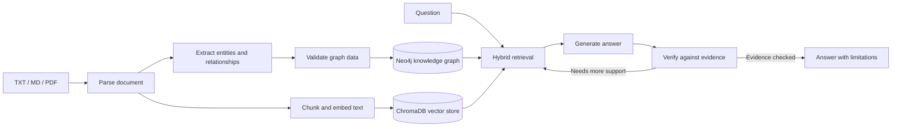

# 🧠 CRITIC-MedRAG

**From medical text to evidence-checked answers.**

CRITIC-MedRAG is an experimental medical information-retrieval project. It combines a **Neo4j knowledge graph** with **ChromaDB semantic search**, then uses a verification-and-retrieval loop to help keep generated answers tied to retrieved evidence.

> [!WARNING]
> **Research/demo software only.** This project is not a medical device and must not be used for diagnosis, treatment, or other clinical decisions. Included medical notes and relationships are synthetic.

## What makes it interesting?

- **Two ways to find evidence:** graph paths capture explicit relationships; vector search finds relevant text passages by semantic similarity.
- **A check-and-retrieve loop:** answers are checked against retrieved evidence. When support is weak, the pipeline can refine the retrieval query and try again a bounded number of times.
- **Structured extraction:** medical entities and relationships are validated against the project's graph schema before graph ingestion.
- **Try it at different levels:** use the command line for document ingestion, or the Streamlit dashboard for an interactive extraction flow.
- **Synthetic data by design:** explore graph and retrieval behavior without treating example content as real patient information.

## How the pieces fit together



## Features

| Area | What it does |
| --- | --- |
| Document parsing | Reads TXT, Markdown, and PDF input |
| Extraction | Offers deterministic demo extraction and an OpenAI-backed CLI option |
| Knowledge graph | Validates and loads entities and relationships into Neo4j |
| Hybrid retrieval | Combines Neo4j graph paths and ChromaDB text search |
| Answering | Uses Gemini to generate evidence-grounded answers and verify claims, with bounded retries |
| Dashboard | Provides an interactive Streamlit extraction workflow |

## Requirements

- Python 3.10 or newer
- Neo4j for graph ingestion and graph retrieval
- Credentials for the model-backed features you plan to use:
  - **OpenAI** for the CLI `--llm` extraction option
  - **Gemini** for the dashboard and CRITIC answer-generation pipeline

## Get started

### 1. Create a virtual environment

**Windows (PowerShell):**

```powershell
py -m venv .venv
.\.venv\Scripts\Activate.ps1
```

**macOS / Linux:**

```bash
python3 -m venv .venv
source .venv/bin/activate
```

### 2. Install dependencies

```bash
python -m pip install -r requirements.txt
```

### 3. Configure your environment

Copy `.env.example` to `.env` and set values for the services you use. For local Neo4j, the URI is commonly `bolt://localhost:7687`; for Neo4j Aura, use the `neo4j+s://` URI provided by Aura.

| Variable | Used for |
| --- | --- |
| `NEO4J_URI`, `NEO4J_USERNAME`, `NEO4J_PASSWORD`, `NEO4J_DATABASE` | Neo4j connection |
| `OPENAI_API_KEY`, `OPENAI_MODEL` | Optional OpenAI-backed CLI extraction |
| `GEMINI_API_KEY`, `GEMINI_MODEL` | Dashboard and answer generation / verification |

Keep `.env` private; it is excluded from Git.

## Run it

### Ingest the sample with deterministic demo extraction

This avoids a model API call, but still requires a reachable Neo4j database:

```bash
python -m src.main --file data/sample_medical_notes.txt
```

### Use OpenAI-backed extraction

```bash
python -m src.main --file data/sample_medical_notes.txt --llm
```

### Open the Streamlit dashboard

```bash
streamlit run src/dashboard.py
```

The dashboard uses Gemini for extraction and Neo4j for graph operations.

## Project layout

```text
data/   Synthetic sample medical notes
src/    Parsing, extraction, graph, retrieval, generation, and verification
```

The ChromaDB index lives in `chroma_db/`. It is local application data, excluded from Git, and can be recreated by the workflows that populate the vector store.
